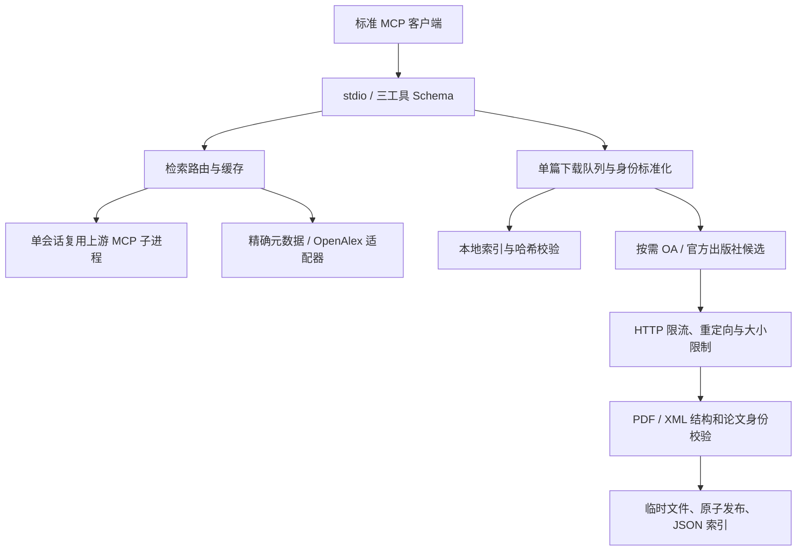

# 实现与扩展

## 数据与状态

`models/paper.ts` 定义统一 `Paper`、`Location`、来源状态、下载结果。DOI 标准化为小写；标识符使用 SHA-256 形成固定文件名，不使用外部标题或响应文件名组成路径。无 DOI 的 arXiv 文献以 `arxiv:带版本ID` 标识，保留预印本语义。

去重只合并精确 DOI，来源记录和各库计数分别保留。空计数不与零混淆。引文计数是各库在查询时返回的观察值，不可相加。无 DOI 的记录用来源和 ID 去重，不通过相似标题将不同论文合并。

工具响应的状态与来源状态分离：搜索部分来源失败时仍可返回其他来源；精确元数据仅在全部查询明确未收录时返回 `not_found`；全文获取失败不反推文献不存在。预印本、作者接受稿、出版版由每个 OA 位置及下载记录独立标记。`available_formats` 是元数据提示或已验证本地格式，不保证未来请求成功。

## 上游边界

不导入上游 Server 到主进程。`Upstream` 懒启动固定 npm 包的 stdio 进程，同一会话保持连接。只允许调用指定检索及 WoS 引文工具，绝不转发 `all`、Sci-Hub、Scholar 爬虫或上游直接下载。子进程 cwd 为临时空目录，环境只转发必要变量；ScrapingAnt/Sci-Hub 明确禁用，商业凭据仅按本地授权转发。退出时关闭连接、终止子进程并清理 cwd。

上游 Crossref 搜索可复用，但其模型损失原始空计数、部分字段和 DOI 精确错误；`get_paper` 的 Crossref/OpenAlex/Semantic Scholar 查询使用独立原始 API 适配层来满足精确性与诊断要求。未改动上游代码。

上游取消实现有局限，超时/取消时主动终止共享子进程；这可能使同时进行的其他上游请求失败，下次重新连接。主进程 HTTP 使用 AbortSignal，并为等待队列和每次请求设置边界。

## 下载与权限

`Discovery` 只产生已核实身份关系的候选，`DownloadService` 决定访问顺序与权限，`Library` 只处理本地完整性和发布。候选成功即停止；XML 可先保留，再在当前请求预算内继续找 PDF。

OA 候选来自 DOI 匹配记录。一般仓储 PDF 要在前两页找到目标 DOI，识别不到就保守失败；没有启用标题相似度替代。arXiv 通过官方 ID/版本映射，显式同时给 DOI 与 arXiv ID 时额外检查关系；`10.48550/arxiv.ID` 可由其标识语义映射。出版社 DOI 全文接口与 Springer/Europe PMC 的精确记录可作为官方身份依据，返回中若发现不一致的结构化 DOI 则拒绝保存。

权限声明仅是本地使用策略，不是许可认证服务。实际 401、403、429 仍分别返回。Wiley 的 404 有订阅语义，保守归为受限。Elsevier/XML 仅在含真实全文 body/originalText 等结构时保存；元数据包、错误文档、登录 HTML 均不当作全文。

## 存储与网络假设

目录校验通过 node:path 解析实际平台的根，完整保留 Windows 盘符与 UNC 根；realpath 比较允许 Windows 的大小写/命名空间规范化，不将其视为路径跳转。

每个标识符跨进程持有独占文件锁。原始响应有大小上限，缓冲后写唯一临时文件，验证成功后原子发布；默认使用不覆盖的 hard-link 发布。自定义目录必须属于允许根，不接受符号链接目录。索引按篇原子更新，避免整个库的读写覆盖。

普通异常清除临时文件；强杀或断电需人工核对残留锁/临时文件。先发布文件、后更新索引的崩溃窗口可能留下未索引的有效文件；默认保留并报告冲突，不覆盖它。JSON 索引不是数据库事务或备份，重要文献应自行备份。磁盘缓存和本地索引不跨用户共享。

HTTP 仅接受公共 HTTPS 443 URL，实际 DNS 建连时校验目标，重定向逐跳校验并移除跨域凭据。可信 HTTP 代理远端解析不可能由本项目完全约束；使用代理时本地仍预查 DNS。Fake-IP 兼容仅按私有配置精确域名开放保留网段，保持 TLS 认证；不将整个内网加入允许列表。

Wiley 在共享文献库内持久化 11 秒请求间隔，其他来源使用上游及主进程各自限速。主进程所有下载低并发，元数据查询有界并发。供应商真实配额始终以账户与 API 响应为准；上游 WoS 的本地日计数仅在单个子进程内生效，不应视为跨机器计费预算保证。

## 增加适配器

1. 核对官方 API、许可证、认证方式、速率和允许格式；补充 `docs/sources.md`。
2. 按 `PublisherDownloadAdapter` 契约定义来源支持条件和候选发现，输入为精确 DOI，输出为候选及身份依据。
3. 在配置和 `DownloadService` 路由中登记来源；新增单独授权名，不自动加入全部既有调用。
4. 使用共享 HTTP、存储与验证层，避免自行写文件或回退到网页爬虫。
5. 补充真实请求 Schema、认证/格式/身份/异常离线测试；有实际授权再做在线验证，分别记录证据。

不增加第四个 Agent 工具。Zotero、BibTeX 等导出应作为独立服务模块设计，第一版未实现。
